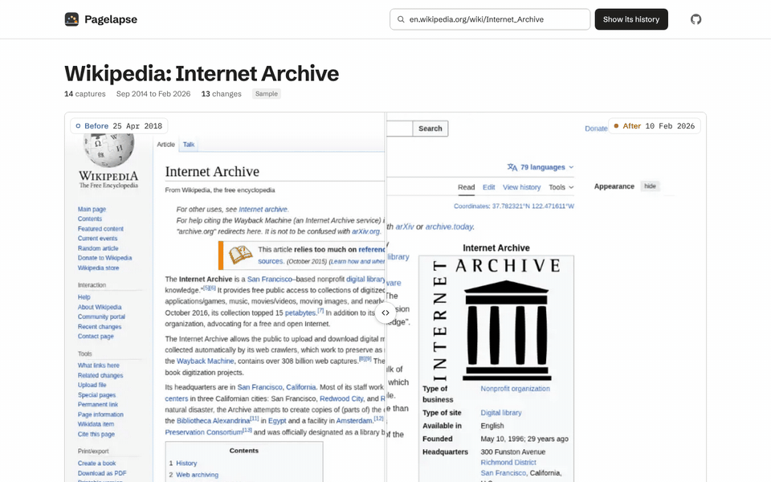
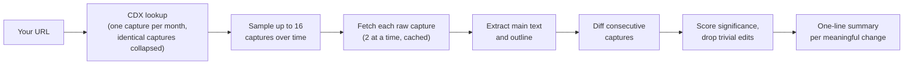

# Pagelapse

**Pagelapse**: scrub through a decade of any web page. See how it looked and what changed, capture by capture, from the Internet Archive.

`MIT licence` `no API key needed` `works offline for samples`

**Live demo:** [pagelapse.geekplux.com](https://pagelapse.geekplux.com), or [run it yourself in 10 seconds](#try-it-in-10-seconds).


Paste a URL. Pagelapse finds the page's captures in the Wayback Machine, keeps the ones where something meaningful changed, and lays them out as a time-lapse. You can drag a divider between the looks before and after each change, play a built-in sample's decade back, read exactly which words changed, and get one line per change that says what happened.



## Try it in 10 seconds

You need [pnpm](https://pnpm.io/installation) 9. It fetches the pinned Node 24 for this project by itself (`.npmrc`).

```sh
git clone https://github.com/geekplux/pagelapse.git && cd pagelapse
pnpm i && pnpm dev
```

Open the address `pnpm dev` prints (usually http://localhost:5173). The first view deals the captures of the built-in Wikipedia sample. Open a card or a sample (Wikipedia, NASA or Creative Commons): their text and pictures ship with the app, so they need no network, no account and no key. Or paste any URL to look it up live in the Internet Archive. The [examples gallery](examples/README.md) has deep links to the best changes and five pages to try.

## Features

- **The visual scrub.** See the page as it looked at each capture. The time ribbon joins a thumbnail of every capture to its date on a year axis, with a bar per change that grows with its size. Arrow keys, a drag or a click move through the years.
- **Compare modes.** Slider (drag the divider between Before and After), Side by side and Single (flip Before / After).
- **Play.** A pausable time-lapse of a sample, one capture every 1.2 s. It only starts when you press it.
- **Only meaningful changes.** Whitespace, dates, visit counters and tracking parameters are recognised as trivial and hidden. "Every change" lists the rest, newest first, and says how many were hidden, with a way to show them.
- **The text diff.** Added and removed words are marked with `+` / `−`, underline and strike-through, not colour alone. Heading changes are listed as added, removed or renamed.
- **A one-line summary per change.** A deterministic "auto summary" always works. A deployment with Workers AI writes an "AI summary" instead. Each line says which kind it is.
- **Shareable links.** The address keeps the sample or URL, the selected change and the compare mode, and "Copy link" copies it.
- **Light and dark themes** follow your system setting.

## How it works



1. The browser asks the Pagelapse Worker (Cloudflare) for the page's captures. The Worker queries the Wayback CDX API and picks up to 16 captures spread over time, preferring captures whose size changed.
2. For each capture, the Worker fetches the raw archived HTML (the `id_` URL), extracts the readable text and the heading outline, and caches the result. It never stores raw HTML.
3. The browser diffs consecutive captures, scores how much changed, and drops trivial edits. The time ribbon fills in as captures arrive.
4. Summaries for the meaningful changes are requested in small batches as changes are found.

### Where AI is used (and where it is not)

AI writes **one thing**: the one-line summary of a meaningful text change, using Workers AI (`@cf/meta/llama-3.2-3b-instruct`) in the deployed Worker. Up to 8 changes go in one call, each pair of captures is summarised at most once and cached, and a daily cap applies. A missing binding, an error, a rate limit or an invalid answer falls back to the deterministic summary for that change.

Everything else is deterministic code: sampling, extraction, diffing, scoring, the trivial-edit filter, the fallback summaries, the pictures and the compare modes. No model ever sees a picture. The built-in samples and local development (`pnpm dev`) use the deterministic summaries only, so they need no key.

### Where the pictures come from

- **Samples:** screenshots of the top of each archived capture (1280×800, stored as 960×600 WebP), recorded once with `pnpm record:visuals` and committed under `public/samples/`. They were recorded from [Arquivo.pt](https://arquivo.pt/)'s replay, because the Internet Archive could not be reached from the machine that recorded them. See [`public/samples/README.md`](public/samples/README.md).
- **Live runs:** the Internet Archive's own replay of the capture you select, in a sandboxed frame, loaded straight from `web.archive.org` by your browser. Archived copies can lack some styles or images, and the pane says so. Live thumbnails on the ribbon are text outlines drawn from the extracted page, not pictures.

## Being kind to the Internet Archive

- Every request identifies itself: `pagelapse/<version> (+https://github.com/geekplux/pagelapse)`.
- At most 16 captures per page, fetched 2 at a time. Busy pages are collapsed to one capture per month first.
- Everything is cached: the Worker keeps capture lists for 24 hours and extracted captures and summaries for good, and its responses carry cache headers so your browser reuses them.
- If the Archive answers 429, the Worker stops all uncached requests for at least 60 s and tells you when to retry. Server errors are retried with backoff, and pages over 2 MB are cut off. Each visitor also has their own limit on uncached lookups.
- A replay frame loads only for the capture you pick, after the selection has rested for 400 ms. At most 3 frames are kept, and nothing is preloaded while a run is still fetching.

## Privacy

Pagelapse has no accounts, cookies or analytics. A live lookup sends the URL to the Pagelapse Worker so it can query the archive, and the deployment's Cloudflare request logs may record it. Live pictures load directly from the Internet Archive in your browser, just like visiting the Wayback Machine. The built-in samples load nothing but the app's own files.

## Accessibility

- Everything works from the keyboard: the time ribbon is a slider, its thumbnails and the Before / After pair are single tab stops moved with the arrow keys, the samples are options of the address field, and the footer lists every shortcut.
- Changes never rely on colour alone. They use `+` / `−` symbols, underline and strike-through, magnitude words and bar heights, and screen readers hear "added" and "removed" text.
- The palette is checked in the unit tests for contrast and for protanopia, deuteranopia and tritanopia. Cyan marks Before and amber After, always with a word, a ring or a dot.
- Reduced-motion settings turn off cross-fades and smooth scrolling, and nothing plays by itself.
- axe-core and keyboard flows run in headless Chrome. Testing with more screen readers is welcome: please [open an issue](https://github.com/geekplux/pagelapse/issues/new/choose) for anything that gets in your way.

## Deploy your own

Pagelapse runs on Cloudflare: one Worker for `/api/*`, with the app and the sample pictures served as static assets. You need a Cloudflare account, one KV namespace and nothing else (no API keys). Check everything without an account first:

```sh
pnpm build && pnpm run check:deploy
```

[docs/DEPLOY.md](docs/DEPLOY.md) has the prerequisites, the Workers Builds settings, the deploy command, post-deploy checks, rollback, costs and limits, and which links to change for your own domain.

## Roadmap

- Re-recording the samples from the Internet Archive itself.
- An optional screenshot provider for live thumbnails (Cloudflare Browser Rendering). It is designed but not built: see [EXTENDING](docs/EXTENDING.md#optional-screenshot-provider-designed-not-built).
- Smaller ideas are listed in [good first issues](docs/GOOD_FIRST_ISSUES.md).

## Contributing

Issues and pull requests are welcome. [CONTRIBUTING.md](CONTRIBUTING.md) covers the setup, the checks and the design rules (crowding the screen counts as a bug). [docs/EXTENDING.md](docs/EXTENDING.md) shows how to add a sample, a summariser or an archive. Please follow the [Code of Conduct](CODE_OF_CONDUCT.md), and report security problems as described in [SECURITY.md](SECURITY.md). Changes are listed in the [CHANGELOG](CHANGELOG.md).

## Credits

- The [Internet Archive](https://archive.org/) and its [Wayback Machine](https://web.archive.org/) are the source of every live capture.
- [Arquivo.pt](https://arquivo.pt/) served the captures that the built-in samples were recorded from.
- Sample texts and pictures:
  - the Wikipedia article "Internet Archive" by Wikipedia contributors (CC BY-SA 4.0, CC BY-SA 3.0 before June 2023; a trimmed excerpt, without the blocks that state monetary figures);
  - www.nasa.gov by NASA (a US government work, generally not subject to copyright in the United States; the NASA insignia and logos are protected, and third-party images on the site may not be in the public domain; a trimmed excerpt, without the blocks that state monetary figures or budgets);
  - creativecommons.org by Creative Commons (CC BY 4.0; a trimmed excerpt, without the blocks about donations or that state monetary figures; Creative Commons and the CC logos are trademarks of Creative Commons).

  The pictures are screenshots of archived captures. The page designs, logos and text belong to their authors. Details are in each sample's "About these captures" and in [`public/samples/README.md`](public/samples/README.md).
- [Schibsted Grotesk](https://github.com/schibsted/schibsted-grotesk) by The Schibsted-Grotesk Project Authors, under the [SIL Open Font License 1.1](public/fonts/OFL-SchibstedGrotesk.txt).
- [IBM Plex Mono](https://github.com/IBM/plex) by IBM Corp., under the [SIL Open Font License 1.1](public/fonts/OFL-IBMPlexMono.txt).

## Licence

[MIT](LICENSE) © geekplux and Pagelapse contributors.
