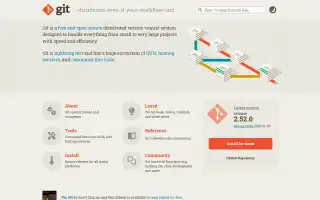
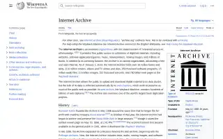
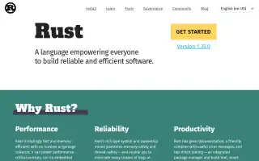

# Examples

Three built-in samples to start with, and five pages to try live. The sample links open a change and a compare mode directly.

The links point at a local copy of Pagelapse. Run `pnpm i && pnpm dev` first ([quick start](../README.md#try-it-in-10-seconds)). If your dev server uses another port, change `5173` in the address. The samples need no network and no key.

## The built-in samples

### git-scm.com home page (2013–2025)

The Git project's home page, captured 14 times over twelve years. The design stays recognisable, so the small changes are easy to spot.

What to look for:

- The release box. It was a monitor drawing with "Download for Linux" and became a flat card with "Install for Linux" in 2025. The release number climbs from 1.8.4.2 to 2.52.0.
- The opening paragraph gets shorter. The comparison with "Subversion, CVS, Perforce, and ClearCase" and the "Try Git" line are gone by 2025.
- The four topic tiles (About, Documentation, Downloads, Community) become six (About, Learn, Tools, Reference, Install, Community).

Open it:

- [2013·11·06 → 2025·12·18, the decade compare, in Slider](http://localhost:5173/?sample=git-scm&view=slider): the first view. Drag the divider across twelve years.
- [2025·04·04 → 2025·12·18 in Slider](http://localhost:5173/?sample=git-scm&change=20250404010448-20251218145830&view=slider): the 2025 redesign of the lower half on its own.
- [2013·11·06 → 2014·09·08 in Single](http://localhost:5173/?sample=git-scm&change=20131106090756-20140908183445&view=single): a tiny change. Flip Before / After and watch the release card.

### Wikipedia: Internet Archive (2014–2026)

The encyclopedia article about the archive itself. Pagelapse shows a trimmed excerpt of the text, and the pictures hide the rows that state monetary figures.

What to look for:

- The skin change. Wikipedia's 2022 design moves the contents into a sidebar and brings a new header.
- The article growing and being reworded. The text diff marks each added and removed passage.
- The "Cyberattacks" section added in 2025 and renamed "2024 cyberattacks" later.

Open it:

- [2022·02·02 → 2023·03·26 in Slider](http://localhost:5173/?sample=wikipedia-internet-archive&change=20220202204805-20230326224104&view=slider): the 2022 design arrives.
- [2024·03·16 → 2025·05·02 in Side by side](http://localhost:5173/?sample=wikipedia-internet-archive&change=20240316020238-20250502083649&view=side): the cyberattacks section.

### rust-lang.org home page (2018–2026)

The Rust project's home page, from just after its 2018 redesign. Two captures have no picture because the archive's copy lacks the main stylesheet. The pane says so instead of showing a broken page.

What to look for:

- The "Rust 2018 Edition is here!" banner, there in December 2018 and gone by June 2019.
- The tagline, reworded from "Empowering everyone to build reliable and efficient software" to "A language empowering everyone…".
- New sections on the page in 2020, such as "Build it in Rust".

Open it:

- [2018·12·20 → 2019·06·24 in Slider](http://localhost:5173/?sample=rust-lang&change=20181220082130-20190624102109&view=slider): the banner goes, the tagline changes.
- [2019·06·24 → 2020·01·12 in Onion skin](http://localhost:5173/?sample=rust-lang&change=20190624102109-20200112221536&view=onion): fade the newer capture over the older one.

## Try these live

Paste any of these into the address field. A live lookup asks the Internet Archive for up to 16 captures, two at a time, so the first run of a page takes a little while. Later runs come from the cache.

| Page | Why it is interesting |
| --- | --- |
| [w3.org](http://localhost:5173/?url=https%3A%2F%2Fwww.w3.org%2F) | The Web's standards body, with decades of redesigns and changes to how it describes itself. |
| [gnu.org](http://localhost:5173/?url=https%3A%2F%2Fwww.gnu.org%2F) | A famously steady design, so its text changes show up clearly. |
| [kernel.org](http://localhost:5173/?url=https%3A%2F%2Fwww.kernel.org%2F) | The Linux release table: a new version line almost every capture. |
| [nasa.gov](http://localhost:5173/?url=https%3A%2F%2Fwww.nasa.gov%2F) | A large public site whose front page has been rebuilt several times. |
| [whatwg.org/faq](http://localhost:5173/?url=https%3A%2F%2Fwhatwg.org%2Ffaq) | A long FAQ page where answers are added and reworded over the years. |

Live pictures come straight from the Internet Archive's replay, so some captures look unstyled or miss images. The pane marks them, and the text diff still works.
