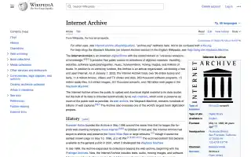
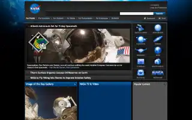
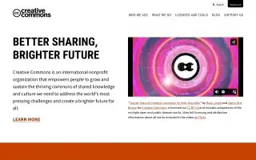
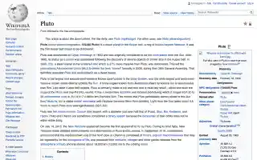
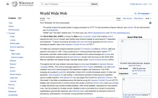
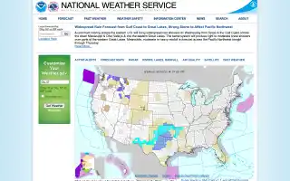

# Examples

Six built-in samples to start with, and five pages to try live. The sample links open a change and a compare mode directly.

The links open the live demo at https://pagelapse.geekplux.com. To use a local copy instead, run `pnpm i && pnpm dev` ([quick start](../README.md#try-it-in-10-seconds)) and replace `https://pagelapse.geekplux.com` with `http://localhost:5173` in the address. The samples need no network and no key.

## The built-in samples

### Wikipedia: Internet Archive (2014–2026)

The encyclopedia article about the archive itself, and the default sample: the first view deals its captures. Pagelapse shows a trimmed excerpt of the text, and the pictures hide the rows that state monetary figures.

What to look for:

- The skin change. Wikipedia's 2022 design moves the contents into a sidebar and brings a new header.
- The article growing and being reworded. The text diff marks each added and removed passage.
- The "Cyberattacks" section added in 2025 and renamed "2024 cyberattacks" later.

Open it:

- [2018-04-25 → 2026-02-10, the decade compare, in Slider](https://pagelapse.geekplux.com/?sample=wikipedia-internet-archive&view=slider): what the sample opens on, its earliest complete capture against its latest. Drag the divider across eight years.
- [2022-02-02 → 2023-03-26 in Slider](https://pagelapse.geekplux.com/?sample=wikipedia-internet-archive&change=20220202204805-20230326224104&view=slider): the 2022 design arrives.
- [2024-03-16 → 2025-05-02 in Side by side](https://pagelapse.geekplux.com/?sample=wikipedia-internet-archive&change=20240316020238-20250502083649&view=side): the cyberattacks section.

### NASA home page (1997–2026)

NASA's home page, captured 11 times over almost thirty years, from the 1997 image map to today's full-width mission photos. Most captures from 2010 to 2012 are partial copies: the archive kept the layout but not the slideshow images, so parts of those pictures are empty dark boxes, and the pane tags them as partial.

What to look for:

- The 2008 redesign. The pale 1998 and 2000 pages, with a sidebar of links down the left, become a dark portal with a featured story and topic tiles.
- The lead story of each capture: the STS-88 launch date in 1998, a hurricane shelter for the Space Shuttle in 2000, the Artemis II crew's return in 2026.
- The 2023 rebuild, with "Welcome to NASA's new website" and the Psyche asteroid across the whole page.

Open it:

- [2000-08-15 → 2008-02-15 in Slider](https://pagelapse.geekplux.com/?sample=nasa&change=20000815052806-20080215055318&view=slider): the dark redesign arrives, what the sample opens on.
- [2023-09-29 → 2026-04-13 in Side by side](https://pagelapse.geekplux.com/?sample=nasa&change=20230929171030-20260413235549&view=side): the Psyche mission makes way for "Welcome Home".

### Creative Commons home page (2009–2026)

The home page of the organisation behind the CC licences, captured 14 times over seventeen years and several designs. Five captures have no picture: Arquivo.pt could not replay four of them, and one was left out because it showed a fundraising price. The pane says so instead of showing a broken page.

What to look for:

- The green 2009 design with its news columns, then the 2011 slider above Mission, License and Explore boxes.
- The orange 2016 design and its headline "When we share, everyone wins".
- The black-and-white 2023 design ("Better Sharing, Brighter Future") and the 2026 one ("The commons belongs to us all").

Open it:

- [2022-02-17 → 2023-10-19 in Slider](https://pagelapse.geekplux.com/?sample=creative-commons&change=20220217002410-20231019221042&view=slider): the twentieth-anniversary page gives way to the 2023 design, what the sample opens on.
- [2009-05-06 → 2009-09-03 in Single](https://pagelapse.geekplux.com/?sample=creative-commons&change=20090506024533-20090903130655&view=single): a smaller change inside the green design. Flip Before / After and watch the feature boxes and the news.

### Wikipedia: Pluto (2009–2026)

The encyclopedia article about Pluto, captured 12 times. Its lead goes from a probe that "is due to" visit in 2015 to the flyby and what New Horizons found. Two captures have no picture: one showed a fundraising notice, and the archive replays one without its styles.

Open it:

- [2015-04-08 → 2018-04-06 in Side by side](https://pagelapse.geekplux.com/?sample=wikipedia-pluto&change=20150408211802-20180406222435&view=side): before and after the flyby, what the sample opens on.

### Wikipedia: World Wide Web (2008–2026)

The article about the Web itself, captured 14 times over eighteen years: from the 2008 Monobook skin, through the "Internet" navigation box of 2013, to Wikipedia's 2022 design and a new section on the competition with Gopher.

Open it:

- [2022-09-11 → 2024-01-24 in Slider](https://pagelapse.geekplux.com/?sample=wikipedia-world-wide-web&change=20220911180807-20240124130859&view=slider): the 2022 design arrives, what the sample opens on.

### weather.gov home page (2009–2026)

The National Weather Service's home page, captured 14 times: the same idea, a national map of warnings under the day's headline, in two designs. Each capture leads with that day's weather, so the text diff reads like a weather diary.

Open it:

- [2011-01-14 → 2013-11-06 in Slider](https://pagelapse.geekplux.com/?sample=weather-gov&change=20110114192848-20131106175252&view=slider): the blue sidebar design gives way to the 2013 one, what the sample opens on.

## Try these live

Paste any of these into the address field. A live lookup asks the Internet Archive for up to 16 captures, two at a time, the first and latest first: the decade compare shows within seconds and the years between fill in after. Later runs, by anyone, come from the cache.

| Page | Why it is interesting |
| --- | --- |
| [w3.org](https://pagelapse.geekplux.com/?url=https%3A%2F%2Fwww.w3.org%2F) | The Web's standards body, with decades of redesigns and changes to how it describes itself. |
| [gnu.org](https://pagelapse.geekplux.com/?url=https%3A%2F%2Fwww.gnu.org%2F) | A famously steady design, so its text changes show up clearly. |
| [kernel.org](https://pagelapse.geekplux.com/?url=https%3A%2F%2Fwww.kernel.org%2F) | The Linux release table: a new version line almost every capture. |
| [debian.org](https://pagelapse.geekplux.com/?url=https%3A%2F%2Fwww.debian.org%2F) | A project front page with release announcements and news, steady in design for years. |
| [whatwg.org/faq](https://pagelapse.geekplux.com/?url=https%3A%2F%2Fwhatwg.org%2Ffaq) | A long FAQ page where answers are added and reworded over the years. |

Live pictures come straight from the Internet Archive's replay, so some captures look unstyled or miss images. The pane marks them, and the text diff still works.
